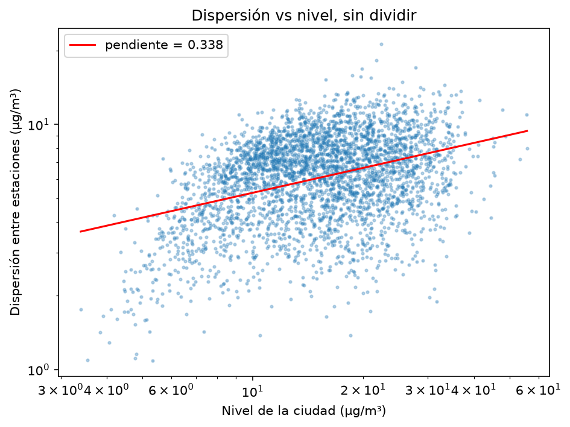
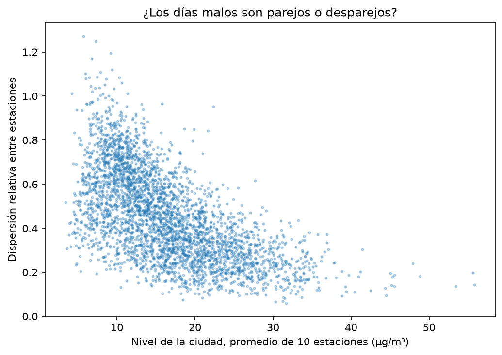

# When Bogotá's air gets worse, does it get worse everywhere?

Ten years of daily PM2.5 from ten monitoring stations across Bogotá, used to test whether
severe pollution days are **city-wide** (driven by regional transport and stagnant air) or
**local** (driven by neighbourhood sources such as heavy traffic corridors).

## Answer

**Bad air days are markedly more uniform across the city than clean days.**

Measuring how the between-station spread `σ` scales with the city-wide daily level `x̄`:

```
σ ∝ x̄^β        β = 0.34,  95% CI [0.24, 0.41]
```

The null hypothesis of interest is β = 1, which would mean spread and level grow together
and the apparent uniformity is an artefact of the ratio. It is rejected by a wide margin:
when the city-wide level doubles, between-station spread grows only ~26%, not 100%.
This is the signature of a source that covers the whole basin rather than a set of point
sources inside it.



## Why this needs care

The intuitive way to ask the question is to plot *relative* spread (σ / x̄) against level,
which produces a convincing downward cloud:



That plot cannot support the conclusion: the level appears on both axes, so the cloud
slopes downward by arithmetic alone even under no real relationship — a spurious
correlation of ratios sharing a term, a problem known since Pearson (1897). The
log-log fit above avoids this by keeping the two axes independent.

Confidence intervals use a **moving-block bootstrap** (30-day blocks, 1000 resamples,
seed 42) rather than resampling individual days. Pollution arrives in multi-day episodes,
so days are not independent observations; the naive bootstrap gives ±0.03, roughly three
times narrower than the honest ±0.09 reported above.

## Data

Daily PM2.5 (µg/m³) from ten stations of Bogotá's air quality monitoring network,
downloaded from **SISAIRE**, the national air quality information system run by IDEAM:

<https://sisaire.ideam.gov.co/ideam-sisaire-web/calidad_aire_municipio.xhtml>

Stations: Carvajal-Sevillana, Guaymaral, Kennedy, Las Ferias, MinAmbiente, Puente Aranda,
San Cristóbal, Suba, Tunal, Usaquén — spanning the northern rural edge to the
industrial south-west.

Raw downloads are **not** redistributed here; the query parameters are documented below so
anyone can reproduce them. The cleaned daily table is included in `data/processed/`.

### Selection rules, fixed before looking at results

| Rule | Value | Reason |
|---|---|---|
| Period | 2017-01-01 to 2026-07-31 | All ten stations active; avoids a pre-2015 change in sub-hourly sampling |
| Valid day | ≥ 8 of 10 stations reporting | Comparing between-station spread requires a near-complete network |
| Result | 3376 of 3499 days retained (96.5%) | |

### A note on data provenance

Daily means arrive without any record of how many hourly readings produced them. The
decimal structure recovers part of it: a mean of hourly values rounded to one decimal can
only land on certain values, so multiplying by the correct divisor returns a "clean"
number. This is the same logic as the GRIM test used to audit published means.

Applied here it is informative but not conclusive — it identifies days built from 19 to 23
hours, but cannot separate 24 from 12. It did reveal something the documentation does not
state: 2014 daily means carry a factor of 3 in their denominators (72, 36, 18, 9),
indicating hourly values that were themselves averages of three sub-hourly readings. That
year uses a different acquisition protocol, which is part of why the analysis starts in 2017.

## Reproducing

```bash
git clone https://github.com/Massinger06/aire-bogota-local-vs-regional.git
cd aire-bogota-local-vs-regional
python3 -m venv .venv && source .venv/bin/activate
pip install -r requirements.txt
jupyter lab
```

`notebooks/01_tabla_maestra.ipynb` runs end to end from `data/processed/`. To rebuild from
raw files, download per-station PM2.5 from the SISAIRE link above (full available range,
CSV export) into `data/raw/` named `<station>_pm25.csv`.

## Limitations and next steps

- **Association, not mechanism.** The scaling is consistent with regional transport, but
  this analysis does not identify a source. Wind speed, rainfall and fire-hotspot data
  would test it directly; SISAIRE carries the meteorological variables.
- **Daily resolution.** Hourly data would separate traffic-driven diurnal peaks from
  multi-day regional episodes. The chosen data are daily means.
- **Ten stations.** The network samples the city unevenly, with sparser coverage in the
  east and south-east.
- **Fixed block length.** The 30-day block was chosen to comfortably exceed typical episode
  duration; estimating the autocorrelation length directly would justify it properly.
- **Not yet done:** characterising which months the high-level, low-spread days fall in,
  and a day-ahead classifier for episode risk with an explicit calibration check.

## Stack

Python, pandas, NumPy, Matplotlib. No modelling libraries are used; everything here is
descriptive statistics and a resampling-based uncertainty estimate.
